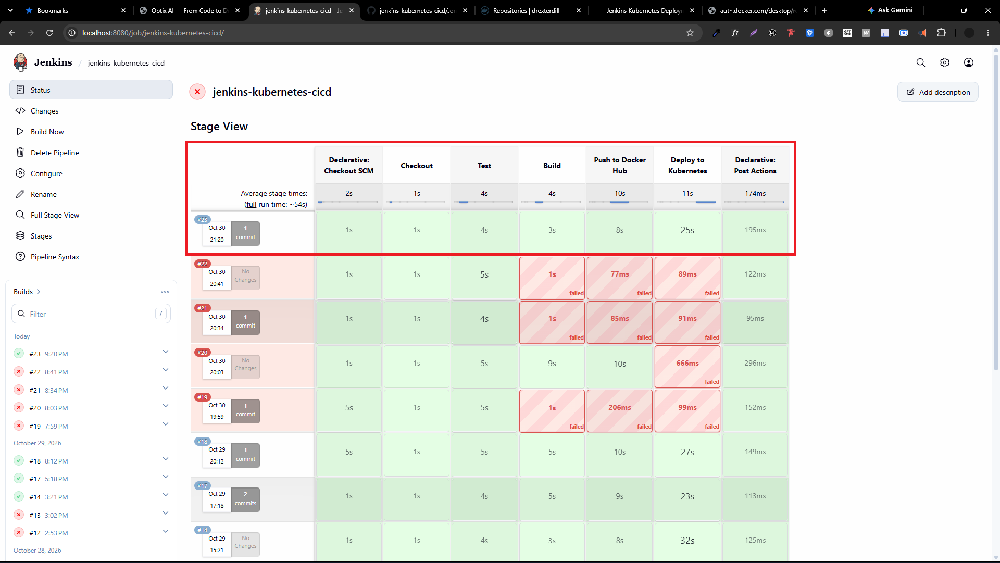
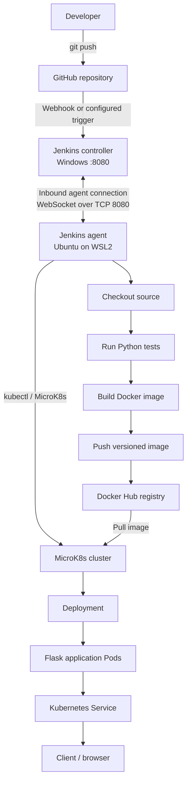
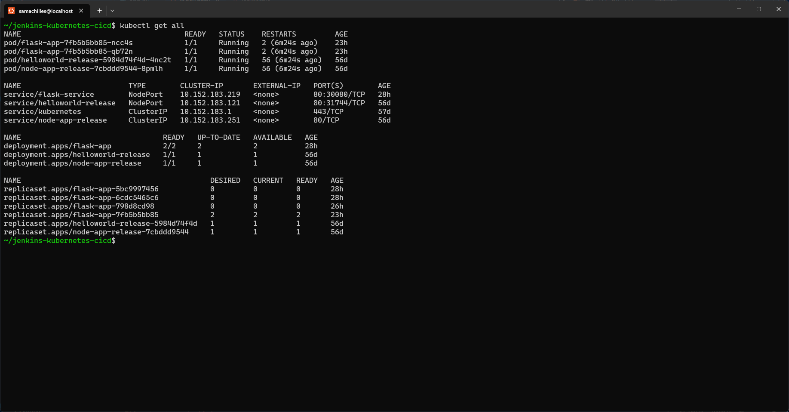

# CI/CD Pipeline with Jenkins, Docker and Kubernetes

Automated build, test, containerization, image publishing, and Kubernetes deployment of a Flask application using Jenkins.




## Project overview

This project demonstrates how a code change can move from GitHub to a running Kubernetes workload through an automated Jenkins pipeline.

The pipeline checks out the source code, runs application tests, builds a Docker image, pushes that image to Docker Hub, updates the Kubernetes Deployment, and verifies the rollout.

The Jenkins controller runs on Windows. A Jenkins agent named `wsl2-agent` runs inside Ubuntu on WSL2 and performs the Linux-based build and deployment commands. The agent has access to Docker, `kubectl`, and the MicroK8s cluster.

## Architecture



### Pipeline stages

1. **Checkout** — retrieves the repository source from GitHub.
2. **Test** — installs the Python dependencies and runs the automated tests.
3. **Build image** — builds the Docker image from the repository's Dockerfile.
4. **Push image** — authenticates to Docker Hub and publishes the image.
5. **Deploy** — updates the Kubernetes Deployment to use the published image.
6. **Verify rollout** — waits for Kubernetes to complete the rollout and checks the workload.

The exact stage names and trigger mechanism should match the committed `Jenkinsfile`.

## Technology stack

| Technology | Purpose |
|---|---|
| Git and GitHub | Source control and code hosting |
| Jenkins | CI/CD orchestration |
| Jenkins agent | Executes pipeline commands in Ubuntu/WSL2 |
| Java | Runtime required by the Jenkins agent |
| Python and Flask | Demo application and tests |
| Python virtual environment | Isolates project dependencies |
| Docker | Builds the application image |
| Docker Hub | Stores the image for Kubernetes to pull |
| Kubernetes / MicroK8s | Runs and manages the application |
| `kubectl` | Applies and inspects Kubernetes resources |
| systemd | Keeps the WSL2 Jenkins agent running in the background |
| PowerShell / Windows Firewall | Allows the WSL2 agent to reach the Windows Jenkins controller |

## Application endpoints

| Endpoint | Purpose |
|---|---|
| `/` | Serves the demo application's `index.html` page |
| `/health` | Health-check endpoint returning `{"status":"healthy"}` |

The Flask application listens on `0.0.0.0:5000` inside the container.

## Key configuration

Use the values that appear in your committed manifests and Jenkinsfile as the source of truth.

| Setting | Value used in the lab |
|---|---|
| Docker Hub namespace | `drexterdill` |
| Image repository | `flask-k8s-demo` |
| Example image tag | `1.0.0` |
| Full example image | `drexterdill/flask-k8s-demo:1.0.0` |
| Kubernetes namespace | `default` unless manifests specify otherwise |
| Flask container port | `5000` |
| Jenkins controller URL from WSL2 | `http://172.18.32.1:8080/` |
| Jenkins agent name | `wsl2-agent` |
| Jenkins agent work directory | `/home/samachilles/jenkins-agent` |

The WSL2 gateway address and subnet can change when the WSL network is recreated. Treat `172.18.32.1` and the firewall subnet documented in the setup guide as lab values, not permanent addresses.

## Run and verify the application

Check the active Kubernetes context before running commands:

```bash
kubectl config current-context
kubectl config get-contexts
```

Confirm that the intended MicroK8s cluster is selected. Then inspect the resources (adjust names if your manifests use different names):

```bash
kubectl get deployments
kubectl get pods -o wide
kubectl get services
kubectl rollout status deployment/flask-app
```

Check application health by forwarding the service port:

```bash
kubectl port-forward service/flask-service 8080:80
```

In another terminal:

```bash
curl http://127.0.0.1:8080/health
```

Expected response:

```json
{"status":"healthy"}
```

If your Service is configured as `NodePort`, you can also inspect its assigned node port:

```bash
kubectl get service flask-service
```



## Important implementation notes

- A Kubernetes Service provides stable network access to matching Pods; it does **not** create or manage the Pods. A Deployment (or another workload controller) must create them.
- A Docker image built on the WSL2 host is not automatically available to every Kubernetes node/runtime. Publishing the image to Docker Hub allows the cluster to pull it.
- Use a unique image tag for each release where possible (for example, a build number or Git commit SHA). Avoid relying only on `latest`.
- The Jenkins agent needs the correct Kubernetes context and sufficient permissions to deploy.
- Store Docker Hub credentials in Jenkins Credentials. Never place passwords, access tokens, or agent secrets in the repository or Jenkinsfile.
- The Jenkins controller and WSL2 agent are separate processes on separate network environments. The agent connection must be reachable through the Windows host firewall.

## What this project demonstrates

- Building a Jenkins pipeline for a containerized application
- Running CI/CD commands on a dedicated Linux Jenkins agent
- Testing a Python application before packaging it
- Building and publishing Docker images
- Deploying an image to Kubernetes
- Updating a Deployment and verifying its rollout
- Diagnosing Python environment, image-pull, Kubernetes-context, and network-connectivity issues

## Learning outcomes

The central lesson is that a successful CI/CD deployment depends on the whole delivery chain: the correct source revision, a passing test stage, a correctly tagged and published image, the intended Kubernetes context, valid workload resources, and an agent with the required network access and permissions.

See [setup-guide.md](setup-guide.md), [troubleshooting.md](troubleshooting.md), and [lesson-learned.md](lesson-learned.md) for implementation details.
