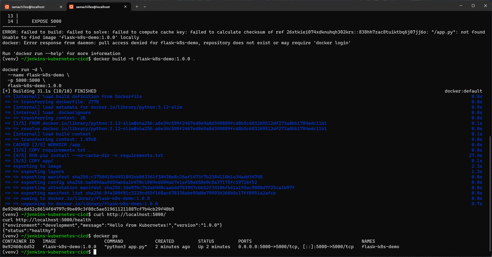
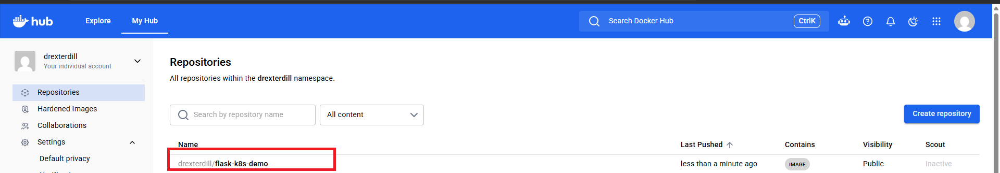

# Setup Guide — Jenkins, Docker and Kubernetes

This guide documents the project lab topology and the main setup/verification steps.

## 1. Lab architecture and prerequisites

The lab uses three logical components:

- **Windows host:** runs the Jenkins controller, available locally on port `8080`.
- **Ubuntu WSL2 environment:** runs the Jenkins agent `wsl2-agent`, Java, Docker CLI/engine access, Git, Python, and Kubernetes tooling.
- **MicroK8s cluster:** the Kubernetes target managed from the WSL2 agent.

The Jenkins agent executes the pipeline commands. The controller coordinates jobs and communicates with the agent.

### Prerequisites

- Windows with WSL2 and an Ubuntu distribution
- Jenkins controller installed and running on Windows
- Java installed in Ubuntu WSL2 (a Java version supported by the installed Jenkins agent/controller)
- Git, Python 3, `venv`, Docker, `kubectl`, and MicroK8s configured in WSL2
- A working MicroK8s cluster
- GitHub repository access
- Docker Hub account and repository
- Permission to configure a narrowly scoped Windows Firewall rule

Check tool availability in Ubuntu:

```bash
java -version
git --version
python3 --version
docker --version
kubectl version --client
microk8s status
```

Confirm Docker and Kubernetes access as the same Linux user that runs the Jenkins agent. A command working in your interactive shell does not guarantee it will work under the agent's service account.

## 2. Prepare the Python application environment

Some Linux distributions mark the system Python installation as externally managed (PEP 668). This protects OS-managed Python packages from being modified by `pip`.

Create and activate a project virtual environment:

```bash
python3 -m venv venv
source venv/bin/activate
```

Upgrade pip and install the project dependencies:

```bash
python -m pip install --upgrade pip
python -m pip install -r requirements.txt
```

Run the tests:

```bash
python -m pytest -v
```

When finished working in the environment:

```bash
deactivate
```

Do not use `sudo pip install` or bypass the externally-managed-environment protection for this project. Keep `venv/` out of Git using `.gitignore`.

## 3. Build and test the Docker image

From the repository root, build the image. Use the exact repository name and tag expected by the Kubernetes manifest and Jenkinsfile:

```bash
docker build -t flask-k8s-demo:1.0.0 .
```

Run the image locally:

```bash
docker run --rm -p 5000:5000 flask-k8s-demo:1.0.0
```


In another terminal, test the health endpoint:

```bash
curl http://127.0.0.1:5000/health
```

Stop the foreground container with `Ctrl+C`.

## 4. Publish the image to Docker Hub

The MicroK8s cluster must be able to retrieve the image. A locally built Docker image is not automatically available to the cluster, so publish it to a registry the cluster can reach.

Authenticate interactively:

```bash
docker login
```

Tag the image with the Docker Hub namespace:

```bash
docker tag flask-k8s-demo:1.0.0 drexterdill/flask-k8s-demo:1.0.0
```

Push it:

```bash
docker push drexterdill/flask-k8s-demo:1.0.0
```



Verify that the repository and tag appear in Docker Hub. For a private Docker Hub repository, configure an appropriate Kubernetes image-pull secret; a public image can normally be pulled without one.

## 5. Check the Kubernetes context

Before applying manifests or changing a Deployment, verify the target cluster:

```bash
kubectl config get-contexts
kubectl config current-context
kubectl cluster-info
kubectl get nodes
```

Select the intended MicroK8s context if necessary. Do not assume the current context is correct simply because `kubectl` returns output.

If your environment uses MicroK8s' bundled kubectl, compare:

```bash
microk8s kubectl get nodes
kubectl get nodes
```

Make sure the Jenkins agent uses the same intended cluster configuration as your interactive WSL2 shell. Do not switch contexts blindly in a production environment.

## 6. Create Kubernetes resources

Apply the Deployment and Service manifests from the repository:

```bash
kubectl apply -f kubernetes/deployment.yaml
kubectl apply -f kubernetes/service.yaml
```

The Deployment's container image must point to the published image, for example:

```yaml
image: drexterdill/flask-k8s-demo:1.0.0
```

The Deployment's selector and Pod-template labels must match. The Service selector must also match the Pod labels.

Inspect the resources:

```bash
kubectl get deployments
kubectl get pods -o wide
kubectl get services
kubectl describe deployment flask-app
```

Wait for the initial rollout:

```bash
kubectl rollout status deployment/flask-app --timeout=120s
```

If your manifest uses a different Deployment name, replace `flask-app` with the actual metadata name.

## 7. Configure the Jenkins controller and WSL2 agent

### 7.1 Confirm the controller

On Windows, confirm Jenkins is running and accessible:

```text
http://localhost:8080
```

The WSL2 agent can use the Windows-side WSL gateway address when loopback forwarding does not provide the required route:

```text
http://172.18.32.1:8080
```

The gateway address is specific to the current WSL network and may change. Determine the current Windows-side gateway from inside WSL2 rather than assuming this example remains valid:

```bash
ip route
```

### 7.2 Create the agent in Jenkins

In Jenkins, create an agent/node with a name such as:

```text
wsl2-agent
```

Configure it for an inbound connection and WebSocket if that is the connection method selected in Jenkins. Use a dedicated remote root directory:

```text
/home/samachilles/jenkins-agent
```

Create the directory in Ubuntu:

```bash
mkdir -p /home/samachilles/jenkins-agent
cd /home/samachilles/jenkins-agent
```

### 7.3 Allow the WSL2 agent to reach Jenkins

If Windows Firewall blocks the inbound connection, create a narrowly scoped rule from an elevated PowerShell session. The following is an example based on one observed WSL2 subnet.

```powershell
New-NetFirewallRule `
  -DisplayName "Jenkins 8080 from WSL2" `
  -Direction Inbound `
  -Action Allow `
  -Protocol TCP `
  -LocalPort 8080 `
  -RemoteAddress 172.18.32.0/20 `
  -Profile Public
```

This allows inbound TCP port `8080` only from the specified remote address range on the Public profile. Do not open port 8080 to all remote addresses. If the controller is bound only to Windows loopback, adjust its listener/binding configuration appropriately; a firewall rule alone cannot make a loopback-only service reachable from WSL2.

Test connectivity from Ubuntu:

```bash
curl -I http://172.18.32.1:8080/login
```

A valid HTTP response indicates that the route reaches Jenkins. A `200`, `302`, or an authentication-related response can all demonstrate HTTP reachability.

### 7.4 Download and launch the agent

Use the agent launch command generated by the Jenkins node page. The command typically downloads `agent.jar` and starts it with the controller URL, node name, secret, WebSocket option, and work directory.

Do not copy agent secrets into documentation, source control, screenshots, or chat. The secret is unique to the agent and must be obtained from the Jenkins UI when configuring the connection.

A generic command shape is:

```bash
curl -sO http://<WINDOWS-WSL-GATEWAY>:8080/jnlpJars/agent.jar

java -jar agent.jar \
  -url http://<WINDOWS-WSL-GATEWAY>:8080/ \
  -secret '<AGENT_SECRET_FROM_JENKINS>' \
  -name 'wsl2-agent' \
  -webSocket \
  -workDir '/home/samachilles/jenkins-agent'
```

Replace the placeholders with the current values from Jenkins. Keep the secret out of shell history where possible; prefer the service configuration's protected environment/credential mechanism and restrict file permissions.

### 7.5 Run the agent as a systemd service

A systemd service allows the agent to run in the background and restart according to its service policy. In this lab, the service file is:

```text
/etc/systemd/system/jenkins-agent.service
```

The working directory is:

```text
/home/samachilles/jenkins-agent
```

The service should run as the normal Ubuntu user that has the required Docker and Kubernetes access, not as root unless there is a specific, justified requirement.

After creating or updating the service:

```bash
sudo systemctl daemon-reload
sudo systemctl enable --now jenkins-agent
sudo systemctl status jenkins-agent
```

Useful service commands:

```bash
sudo systemctl restart jenkins-agent
sudo systemctl stop jenkins-agent
sudo journalctl -u jenkins-agent -f
```

The service depends on WSL2 being running and the Windows Jenkins controller being available. Confirm the agent appears online in Jenkins.

## 8. Verify the agent's execution environment

Run checks as the Jenkins agent user:

```bash
whoami
pwd
java -version
git --version
docker version
kubectl config current-context
kubectl get nodes
```

The agent must be able to:

- Read the GitHub repository
- Run the test command
- Build Docker images
- Authenticate to and push to Docker Hub
- Reach the intended Kubernetes cluster
- Update the Deployment and inspect rollout status

If Docker works in your terminal but fails in Jenkins, check the agent user's Docker group/socket permissions and service environment. Avoid solving this by granting broad, unnecessary privileges.

## 9. Configure Jenkins credentials and pipeline

Create Jenkins credentials for Docker Hub (and GitHub only if the repository requires authentication). Use a Docker Hub access token rather than an account password where possible.

Reference credentials by Jenkins credential ID in the `Jenkinsfile`; never hard-code secrets.

Configure the pipeline job to use the GitHub repository and the repository's `Jenkinsfile`. If using a GitHub webhook, configure the webhook endpoint and Jenkins trigger according to the job type. A webhook is not mandatory if the job uses another configured trigger.

The pipeline should execute on the WSL2 agent label configured in Jenkins. Ensure the label in the `Jenkinsfile` exactly matches the node label in Jenkins.

## 10. Deploy and verify through Jenkins

Trigger a build and inspect each stage:

1. Checkout completes.
2. Tests pass.
3. Docker image builds.
4. Image is pushed to Docker Hub.
5. Kubernetes Deployment is updated.
6. Rollout completes successfully.

After the pipeline:

```bash
kubectl get deployments
kubectl get pods -o wide
kubectl get services
kubectl rollout status deployment/flask-app --timeout=120s
```

Test the application:

```bash
kubectl port-forward service/flask-service 8080:80
```

Then, from another terminal:

```bash
curl http://127.0.0.1:8080/health
```

Note:

8080:80 — local port 8080 forwarded to Service port 80.
80:5000 — Service port 80 forwards to container port 5000.
30080 — NodePort for accessing the application through the Kubernetes node.

Use the actual Deployment and Service names from your manifests if they differ from the examples.

## 11. Operational notes

- WSL2 must be running for the agent service to run.
- The Windows Jenkins controller must be available before the agent can connect.
- WSL2 gateway IPs and subnet ranges can change.
- Confirm the active Kubernetes context before every deployment.
- Publish the image before asking Kubernetes to pull it.
- Prefer immutable/versioned image tags over repeatedly reusing `latest`.
- Keep credentials out of Git and rotate any secret that has been exposed.
